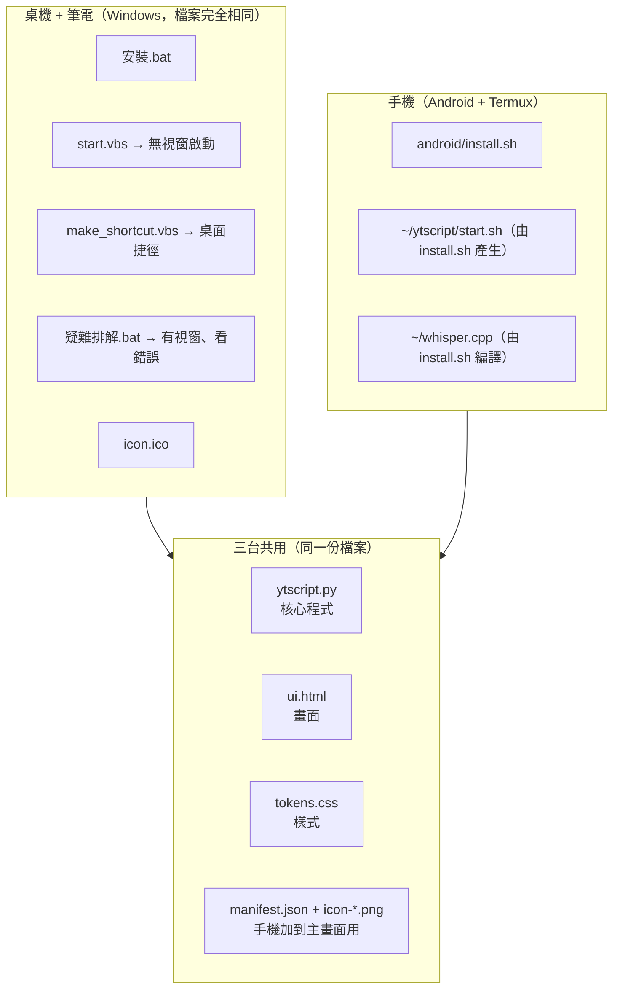
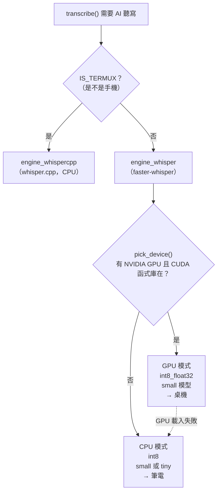
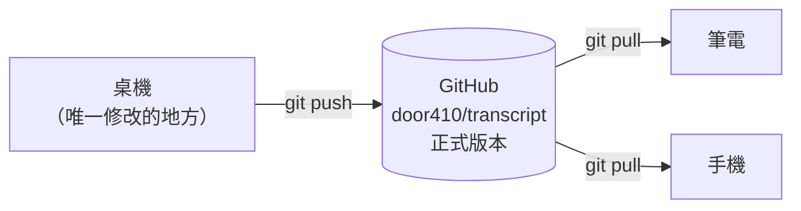

# 02　專案總覽與三個版本

> 對應原本需求的《01 專案總覽》《02 三個版本的差異》《13 三個版本如何維護》與「第二階段」。

---

## 1. 這個工具在做什麼（一段話）

使用者貼上影片連結 → 程式去抓影片的字幕（抓不到就下載音訊、用本機 AI 聽寫）→
整理成「適合貼給 AI 分析」的格式（附上分析指示、影片資訊、章節、每 45 秒一個時間戳）→
使用者按「複製全部給 AI」，貼到 ChatGPT／Claude／Gemini。

**全部在自己的機器上執行。** 沒有帳號、沒有雲端、沒有 API key、沒有資料庫。

### 它的本質是一個「本機網站」

這是理解整個專案最重要的一個觀念：

```
┌─────────────── 你的電腦（或手機）────────────────┐
│                                                  │
│   瀏覽器（畫面）          Python 程式（大腦）     │
│   ui.html          ⇄     ytscript.py             │
│   tokens.css   用網址溝通  （網頁伺服器 + 引擎）  │
│              http://127.0.0.1:8756               │
│                                                  │
└──────────────────────────────────────────────────┘
                          │
                          ▼ 只有這裡會連外
               YouTube／其他影片網站、Hugging Face（下載模型）
```

- **ytscript.py** 啟動後會變成一個「只有這台機器自己連得到」的小網站
- **ui.html** 是那個網站的網頁；你看到的按鈕、輸入框都在這裡
- 瀏覽器和 Python 之間用網址（`/api/start`、`/api/status`）互相傳話
- 所以：**畫面的問題去 ui.html 找，功能的問題去 ytscript.py 找**

---

## 2. 三個版本的真實關係



### 執行時，ytscript.py 怎麼知道自己在哪台？

它不需要你告訴它，**自己偵測**：

| 偵測什麼 | 在哪裡（`ytscript.py`） | 結果 |
|---|---|---|
| 是不是在手機 Termux 裡 | `IS_TERMUX`（約第 84 行） | 檢查環境變數 `PREFIX` 或 `/data/data/com.termux` 資料夾存不存在 |
| 有沒有 NVIDIA 顯卡且 CUDA 函式庫可用 | `pick_device()`（約第 853 行） | 回傳 `"cuda"` 或 `"cpu"` |
| 記憶體多大 | `total_ram_mb()`（約第 902 行） | 決定要用大模型還是小模型 |
| 用哪個 AI 模型 | `default_model_size()`（約第 936 行） | 手機 `tiny`；有 GPU `small`；純 CPU 看記憶體與核心數 |

所以「三個版本」其實是 **同一份程式走三條不同的路**：



**重點：這整張圖只跟「影片沒有字幕、需要 AI 聽寫」有關。**
有字幕的影片（大多數情況）三台走的路完全一樣，跟 GPU 無關。

---

## 3. 三個版本分別說明

### 3.1 GPU 桌機版

| 問題 | 答案 |
|---|---|
| 使用者操作什麼 | 雙擊桌面「YouTube Transcript」捷徑 → 瀏覽器自動開啟 |
| 第一個程式從哪裡開始 | 捷徑 → `wscript.exe start.vbs` → 找到 `pythonw.exe` → 執行 `ytscript.py` 最底部的 `if __name__ == "__main__":` → `serve()` |
| 資料流程 | 見第 04 章（三台相同） |
| 核心邏輯在哪 | `ytscript.py` 的 `transcribe()` |
| 模型在哪 | faster-whisper 模型，存在 Hugging Face 快取（`C:\Users\你\.cache\huggingface\hub\models--Systran--faster-whisper-small` 等），第一次用到時自動下載 |
| GPU 在哪裡介入 | 只有在 AI 聽寫時：`load_whisper_model()` → `pick_device()` → `enable_cuda_dlls()` |
| 安裝時多了什麼 | `安裝.bat` 第 3 步偵測到 `nvidia-smi` → 安裝 `nvidia-cublas-cu12`、`nvidia-cudnn-cu12`（約 2 GB） |
| 程式位置 | 依 `安裝指南.md`：`C:\Users\User\projects\yt-transcript` |

### 3.2 無獨顯筆電版

| 問題 | 答案 |
|---|---|
| 和桌機的程式差異 | **沒有差異。檔案完全相同。** |
| 安裝差異 | `安裝.bat` 找不到 `nvidia-smi`，跳過 CUDA 安裝 |
| 執行差異 | `pick_device()` 回傳 `"cpu"`，AI 聽寫走 CPU（較慢） |
| 沒有 GPU 時程式怎麼處理 | 三道保險：①`pick_device()` 偵測不到就直接用 CPU；②就算偵測到但載入失敗，`load_whisper_model()` 會印「顯示卡無法使用，改用 CPU」；③`_force_cuda_load()` 先用 1 秒無聲測試一次，確定 GPU 真的能跑 |
| 模型選擇 | 記憶體 < 4 GB 或 CPU < 4 核 → `tiny`；否則 `small` |

> 已在桌機上用「假裝沒有 GPU」的方式實測過 CPU 路徑可以正常聽寫（2026-09-24）。

### 3.3 手機版（Android + Termux）

| 問題 | 答案 |
|---|---|
| 使用者操作什麼 | 點 Termux:Widget 桌面小工具「YouTube-Transcript」→ 瀏覽器開 `127.0.0.1:8756`；或在 Termux 輸入 `bash ~/ytscript/start.sh` |
| 第一個程式從哪裡開始 | `~/.shortcuts/YouTube-Transcript.sh` → `~/ytscript/start.sh` → `python ytscript.py` → `serve()` |
| 核心邏輯 | 同一份 `ytscript.py` 的 `transcribe()` |
| **和桌機最大的差異** | ① AI 聽寫用 **whisper.cpp**（`engine_whispercpp`），因為 Android 裝不了 faster-whisper；② 開瀏覽器用 `termux-open-url`（`open_url()`）；③ 模型一律 `tiny`（手機 CPU 弱） |
| 模型在哪 | `~/.cache/whisper-cpp/ggml-tiny-q5_1.bin`（量化版，31 MB） |
| whisper.cpp 在哪 | `~/whisper.cpp/build/bin/whisper-cli`（install.sh 從原始碼編譯） |
| GPU | 不使用 |
| 更新方式 | `cd ~/transcript && git pull`，再重新啟動。手機直接執行 `~/transcript` 裡的程式（`~/ytscript/start.sh` 只是啟動器），不需要複製檔案。⚠️ 2026-09-24 以前安裝的手機要重跑一次 `bash android/install.sh` 換成這個方式 |

### 手機 UI 與桌機 UI 的差異

**是同一個 `ui.html`。** 差別只有 `ui.html` 裡這一段（約第 101～105 行）：

```css
@media (max-width:640px){        /* 螢幕寬度 640 像素以下才套用 = 手機 */
  .inrow{flex-direction:column}  /* 輸入框和按鈕改成上下排 */
  .inrow .fi-btn{width:100%}
  .inrow .fi-input{text-align:left}
}
```

所以：
- **只想改手機的外觀** → 把 CSS 寫在 `@media (max-width:640px){ ... }` 裡面
- **寫在外面** → 桌機、筆電、手機都會變

---

## 4. 三台相同 vs 不同（總表）

| 功能 | 桌機 GPU | 筆電 | 手機 |
|---|---|---|---|
| 畫面、按鈕、選項 | 相同 | 相同 | 相同（窄螢幕排版） |
| 三種分析模式與提示詞 | 相同 | 相同 | 相同 |
| 第 1 層：youtube-transcript-api | 相同 | 相同 | 相同 |
| 第 2 層：yt-dlp | 相同 | 相同 | 相同 |
| 第 3 層：AI 聽寫引擎 | faster-whisper（GPU） | faster-whisper（CPU） | **whisper.cpp** |
| 「快速／準確」選項 | tiny／small | tiny／small 或 tiny | **兩個都是 tiny** |
| 簡繁轉換、快取、長影片切割 | 相同 | 相同 | 相同 |
| 輸出 .md／.txt／.srt | 相同 | 相同 | 相同 |
| 安裝方式 | `安裝.bat` | `安裝.bat` | `android/install.sh` |
| 啟動方式 | 桌面捷徑（start.vbs） | 桌面捷徑（start.vbs） | Termux:Widget（start.sh） |
| 看錯誤訊息 | `疑難排解.bat` | `疑難排解.bat` | Termux 畫面本身就會顯示 |
| 更新方式 | `git pull` | `git pull` | `git pull` |
| 結束方式 | 關分頁，5 分鐘後自動結束 | 同左 | 同左，或在 Termux 按 Ctrl+C |

---

## 5. 需求 → 要修改哪些檔案（對照表）

> 行號是 2026-09-24 的位置，之後會移動。**用函式名稱搜尋最可靠**（VS Code 按 `Ctrl+F`）。
> 「影響」欄：**三台** = 桌機、筆電、手機都會變。

### 5.1 內容與輸出

| 我想要… | 改哪裡 | 影響 | 風險 |
|---|---|---|---|
| 修改「深度學習」提示詞的內容 | `ytscript.py` → `PROMPT_DEEP` | 三台 | 低 |
| 修改「快速摘要」提示詞 | `ytscript.py` → `PROMPT_QUICK` | 三台 | 低 |
| **新增一種分析模式** | `ytscript.py` 新增 `PROMPT_XXX` 並加入 `PROMPTS`；`ui.html` 的 `segPrompt` 加一顆按鈕、`PROMPT_HINTS` 加說明 | 三台 | 低（第 06 章完整示範） |
| 修改「自動字幕可能有錯字」那段提醒 | `ytscript.py` → `CAPTION_NOTE` | 三台 | 低 |
| 修改 Markdown 輸出格式（標題、影片資訊表格） | `ytscript.py` → `build_markdown()` **以及** `split_parts()` | 三台 | 中：⚠️ 長影片的分份輸出是 `split_parts()` 另外組的，**兩個都要改**，否則長影片格式會不一致 |
| 修改純文字輸出 | `build_plaintext()` | 三台 | 低 |
| 修改 SRT 輸出 | `build_srt()` | 三台 | 低 |
| 改段落長度（預設 45 秒） | `ui.html` → `options()` 的 `target_sec: 45` | 三台 | 低。⚠️ 只改 Python 的 `build_paragraphs` 預設值**沒有用**，因為畫面每次都會送 45 過去 |
| 長影片多長才切、每份多大 | `ytscript.py` → `SPLIT_ABOVE`、`PART_TOKENS` | 三台 | 低 |
| 清掉更多口頭禪／雜訊 | `ytscript.py` → `NOISE_PAT`、`FILLER_EN`、`FILLER_ZH` | 三台 | 中：正規表示式寫錯可能刪掉正常內容，交給 AI 並用 selfcheck 驗證 |
| 字幕語言優先順序 | `ytscript.py` → `DEFAULT_LANGS` | 三台 | 低 |
| 簡繁轉換方式 | `ytscript.py` → `OPENCC_PROFILE` | 三台 | 低 |
| 輸出新的檔案格式（例如 .json） | `ytscript.py` → `assemble()` 回傳值加一個欄位；`ui.html` 加按鈕與 `addEventListener` | 三台 | 中 |

### 5.2 畫面（UI）

| 我想要… | 改哪裡 | 影響 | 風險 |
|---|---|---|---|
| 改按鈕上的字、說明文字 | `ui.html` 的 HTML 部分（第 111～221 行） | 三台 | 低 |
| 改選項說明（切換模式時顯示的那段） | `ui.html` → `PROMPT_HINTS`、`SPEED_HINTS` | 三台 | 低 |
| 新增一顆按鈕 | `ui.html`：HTML 加 `<button id="...">`，`<script>` 裡加 `$('#...').addEventListener(...)` | 三台 | 低～中 |
| 改全站顏色、字型、圓角、間距 | `tokens.css`（第 1 節的 `--color-*`、`--space-*`） | 三台 | 低，但影響整個畫面 |
| 只改這個頁面某區塊的樣式 | `ui.html` 開頭的 `<style>` | 三台 | 低 |
| **只改手機畫面** | `ui.html` 的 `@media (max-width:640px){ ... }` 裡 | 只有窄螢幕 | 低 |
| 進度文字多久更新一次 | `ui.html` → `poll()` 裡的 `1500`（毫秒） | 三台 | 低 |
| 手機「加到主畫面」的名稱、顏色 | `manifest.json` | 手機 | 低 |
| App 圖示 | `icon-192.png`、`icon-512.png`、`icon-maskable.png`（手機）；`icon.ico`（Windows 捷徑） | 對應裝置 | 低 |

### 5.3 AI 聽寫與硬體

| 我想要… | 改哪裡 | 影響 | 風險 |
|---|---|---|---|
| 改「準確」模式用哪個模型 | `ytscript.py` → `default_model_size()` | 三台（手機寫死 tiny） | 中 |
| 改「快速」模式用哪個模型 | `ui.html` → `options()` 的 `whisper_model: ... 'tiny'` | 三台 | 低 |
| 改聽寫品質參數（beam） | `ytscript.py` → `engine_whisper()` 裡的 `beam = ...` | 桌機、筆電 | 低 |
| **只改 GPU 桌機的行為** | `pick_device()`、`load_whisper_model()`、`enable_cuda_dlls()`、`_cuda_libs_present()` | 只有有 NVIDIA 的機器 | **高**：這一區有很多實測踩過的坑（見程式註解），請 AI 修改時務必附上整段註解 |
| 改 CUDA 函式庫的安裝 | `安裝.bat` 第 [3/4] 步 | 桌機 | 中（必須維持純 ASCII） |
| 改手機聽寫方式 | `ytscript.py` → `engine_whispercpp()`、`GGML_QUANT`、`find_whisper_cli()` | 只有手機 | 中 |
| 改手機安裝流程 | `android/install.sh` | 只有手機 | 中：改完要在手機上實際重跑一次 |
| 改預估時間的速度表 | `RT_FACTOR`（電腦）、`RT_PHONE`（手機） | 對應裝置 | 低 |

### 5.4 程式行為

| 我想要… | 改哪裡 | 影響 | 風險 |
|---|---|---|---|
| 關掉分頁後多久自動結束 | `ytscript.py` → `IDLE_EXIT_SEC`（秒） | 三台 | 低 |
| 快取保留幾部影片 | `ytscript.py` → `CACHE_MAX_FILES` | 三台 | 低 |
| 改連接埠 8756 | `ytscript.py` → `DEFAULT_PORT`；`android/install.sh` 最後的提示文字 | 三台 | 低 |
| 新增一個 API（例如 `/api/history`） | `ytscript.py` → `Handler.do_GET` 或 `do_POST`；`ui.html` 用 `fetch` 呼叫 | 三台 | 中 |
| 改 Windows 啟動方式 | `start.vbs` | 桌機、筆電 | **高**：⚠️ 必須純 ASCII、CRLF 換行（見 README「給未來的我」） |
| 改桌面捷徑名稱或圖示 | `make_shortcut.vbs` | 桌機、筆電 | 中（同上，純 ASCII） |
| 改套件或套件版本 | `requirements/core.txt`（三台）、`requirements/whisper.txt` 與 `requirements/gpu.txt`（只有電腦）。`安裝.bat`、`ensure_deps()`、`android/install.sh` 都從這裡讀 | 對應裝置 | 中：改完跑 `selfcheck --whisper`；檔案必須純 ASCII |
| 支援新的影片網站 | 通常**不用改**，yt-dlp 已支援上千個網站；更新 yt-dlp 即可 | 三台 | — |

---

## 6. 三種典型修改要動哪些地方

### 情境 A：新增一個「所有版本都要有」的新功能

因為核心共用，**你只要改一次**：

1. 功能邏輯 → `ytscript.py`
2. 畫面 → `ui.html`
3. 如果需要新套件 → 加進 `requirements/core.txt`（三台都要）或 `requirements/whisper.txt`（只有電腦）。三個安裝管道都從這裡讀，不用改安裝腳本
   （新套件在手機上能不能裝，要實測。Android 上很多套件裝不起來，faster-whisper 就是例子）
4. 在桌機測試 → commit → push
5. 筆電、手機：`git pull`，再重新啟動程式
6. 三台各測一次（第 09 章）

### 情境 B：只新增「GPU 桌機」功能

1. 把新程式放在只有 GPU 會走到的地方：`load_whisper_model()` 的 `if device == "cuda":` 區塊內
2. **一定要保留「GPU 失敗就退回 CPU」的保護**（那個 `try / except`）
3. 測試時兩種都要測：桌機（有 GPU）、筆電（沒 GPU，確認沒被影響）
4. 手機不會走到這段程式，但仍要 `git pull` 保持同步（這樣三台檔案一致，將來比較好管）

### 情境 C：只修改手機 UI

1. 改 `ui.html` 的 `@media (max-width:640px){ ... }` 區塊
2. 在桌機測試：按 `F12` → 按「切換裝置工具列」圖示（或 `Ctrl+Shift+M`）→ 選手機尺寸
3. 同時確認桌機寬螢幕沒有被影響
4. commit → push → 手機 `git pull` 並重新啟動 → 在手機上實際看一次

---

## 7. 三個版本如何維護：一條鐵則

> **只在一台機器上改程式（建議：桌機），另外兩台只做 `git pull`。**



為什麼：
- 三台都改 → 三台各自有不同的修改 → 合併時衝突 → 這正是 2026-09-22 發生過的事
  （從 GitHub 網頁上傳了一整份 `mobile/` 資料夾，和桌機的修改分岔，最後要手動合併、再刪掉重複）
- 只有一台改 → 另外兩台永遠只是「下載最新版」，不會衝突

**如果真的要在筆電或手機上改：** 改完立刻 commit + push，回到桌機第一件事就是 `git pull`。

**不要再用 GitHub 網頁的「Add files via upload」上傳程式檔。** 那會繞過你本機的 Git，造成分岔。
