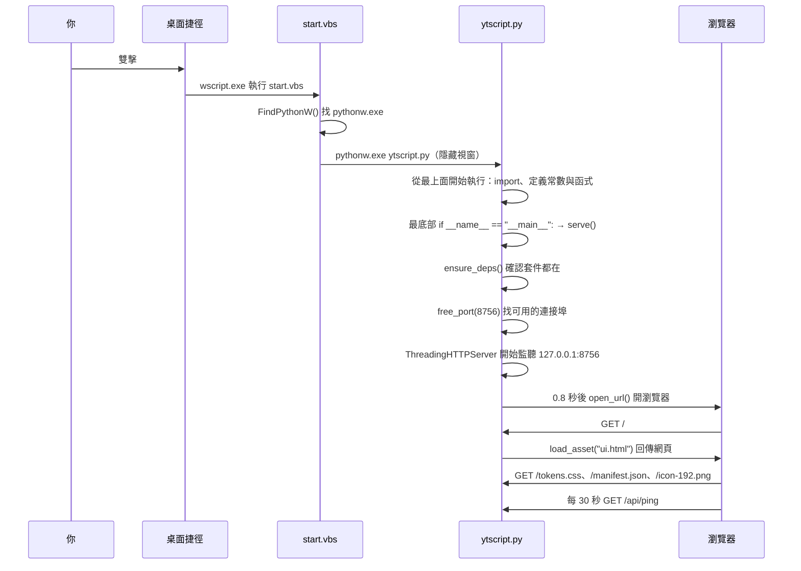
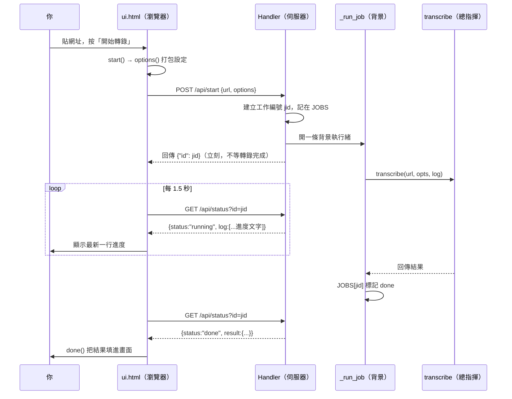
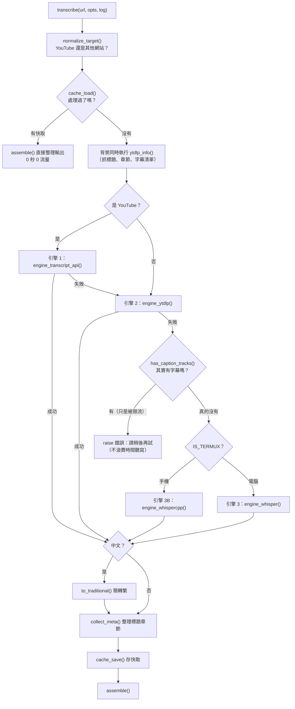

# 04　資料流與逆向理解課程

> 對應原本需求的《05 程式執行流程》《06 使用者操作到程式執行的完整資料流》與「第四階段：零基礎逆向理解課程」。
>
> **這一章的教法：** 不從語法開始。我們從「你按下一個按鈕」開始，一路追到結果出現在畫面上。
> 每遇到一個程式概念，就停下來，**只解釋它在你的工具裡是什麼意思**。
> 沒出現在你專案裡的概念，一個都不教。

---

## 準備：怎麼看程式碼

1. 安裝 **VS Code**（這台電腦已經有了）
2. `檔案 → 開啟資料夾` → 選 `C:\Users\User\projects\yt-transcript`
3. 左邊點 `ytscript.py` 或 `ui.html`
4. **`Ctrl+F` 搜尋名稱**，比記行號可靠
5. **`Ctrl+G` 輸入行號** 跳到那一行
6. 在函式名稱上按 **`F12`**：跳到它被定義的地方；**`Shift+F12`**：列出所有呼叫它的地方
   （這兩個按鍵就是「誰呼叫它、它呼叫誰」的答案，非常好用）

---

## 第一課：程式是怎麼啟動的

### 追蹤路線



手機只差前三步：Termux:Widget → `start.sh` → `python ytscript.py`，之後完全一樣。

### 概念 1：`import`（匯入）

**在你的工具裡長這樣**（`ytscript.py` 第 21～37 行）：

```python
import json
import os
import re
...
from http.server import BaseHTTPRequestHandler, ThreadingHTTPServer
```

- **它是什麼：** 「我要用別人寫好的工具」。`json` 是處理 JSON 格式的工具，`os` 是操作檔案與資料夾的工具，`http.server` 是架網站的工具。
- **為什麼存在：** Python 本身什麼都不會，要用什麼就要先 `import` 什麼。
- **刪掉會怎樣：** 程式一跑到用那個工具的地方就會出現 `NameError: name 'json' is not defined`。
- **你專案裡的特別寫法：** 很多 `import` 寫在**函式裡面**，例如：

  ```python
  def engine_transcript_api(video_id, langs, log):
      from youtube_transcript_api import YouTubeTranscriptApi
  ```

  這叫「用到才載入」。好處：沒裝這個套件時，程式照樣能啟動，只有用到這個功能時才報錯。
  **所以「程式能開，但某個功能壞掉」常常是某個套件沒裝或版本不對。**

- **兩種 import 的差別（你需要知道的程度）：**
  - `json`、`os`、`re`、`threading`… → **Python 內建**，不用安裝
  - `youtube_transcript_api`、`yt_dlp`、`faster_whisper`、`opencc`、`ctranslate2`、`numpy` → **外部套件**，要用 `pip install` 安裝。這些叫做「**依賴**（dependency）」

### 概念 2：常數（大寫的變數）

```python
DEFAULT_PORT = 8756
IDLE_EXIT_SEC = 300
CACHE_MAX_FILES = 100
```

- **它是什麼：** `=` 的意思是「把右邊的值取一個名字」。`DEFAULT_PORT = 8756` 就是「以後說 DEFAULT_PORT，指的就是 8756」。
- **全大寫**是 Python 的習慣，表示「這是設定值，程式執行中不會改它」。
- **在你的專案裡，這些大寫名稱就是「設定檔」。** 想改行為，先找這些（第 03 章 §7 有總表）。
- **改它影響什麼：** 所有用到這個名字的地方。在 VS Code 名稱上按 `Shift+F12` 可以看到有哪些地方用到。

### 概念 3：字串與三引號

```python
UA = ("Mozilla/5.0 (Windows NT 10.0; Win64; x64) ...")      # 一般字串

PROMPT_DEEP = """\
你是一位善於拆解知識型內容的學習夥伴。
...
"""                                                           # 三引號：可以跨很多行
```

- `"..."` 是一段文字（字串）。`"""..."""` 是可以跨很多行的文字。
- **你的三個提示詞就是三段很長的字串。** 修改提示詞 = 修改三引號裡面的文字，**不要動到前後的 `"""`**。
- 開頭的 `"""\` 那個反斜線意思是「第一行的換行不要算」，照留就好。

### 概念 4：`if __name__ == "__main__":`

```python
if __name__ == "__main__":
    args = sys.argv[1:]
    if args and not args[0].startswith("-"):
        r = transcribe(args[0], {"clean": True}, ...)
        ...
    else:
        serve(open_browser="--no-browser" not in args)
```

- **白話：** 「如果這個檔案是被直接執行的（而不是被別的程式借用），就做下面的事。」
- **為什麼存在：** `tools/selfcheck.py` 和 `安裝.bat` 會用 `import ytscript` 借用裡面的函式，那時**不希望**它自動啟動伺服器。
- **這就是整個程式的入口。** 所有啟動方式最後都走到這裡。
- `sys.argv` 是「命令列上打的參數」。`python ytscript.py 網址` → 有參數 → 命令列模式；什麼都沒打 → `serve()` 啟動網頁。

### 概念 5：縮排

注意上面每一層都往右縮了 4 個空格。**在 Python 裡，縮排不是排版，是文法。**
「哪幾行屬於這個 `if`」完全由縮排決定。

**這是 AI 給你程式碼時最常出錯的地方之一：** 貼上時縮排跑掉，程式就會壞（`IndentationError`）。
貼完一定要跑 `python tools/selfcheck.py`，它的第 2 項「主程式可以載入」會抓到這種錯。

---

## 第二課：按下「開始轉錄」之後（最重要的一課）

### 完整路線圖



下面一步一步走。

---

### 步驟 1：按鈕被按下（`ui.html` 第 471 行）

```javascript
$('#go').addEventListener('click', start);
```

**概念 6：事件監聽（addEventListener）**

- 白話：「找到 id 是 `go` 的東西（開始轉錄按鈕），當它被 `click`（點擊）時，執行 `start`。」
- `$('#go')` 是 `ui.html` 自己定義的簡寫（第 224 行），意思是「在畫面上找 id="go" 的元素」。
- **按鈕沒反應時，第一個要查的就是這一行還在不在、id 有沒有對上。**
- 下一行（472）是「在輸入框按 Enter 也執行 `start`」。

---

### 步驟 2：`start()` 打包並送出（`ui.html` 第 290～307 行）

```javascript
async function start() {
  const url = $('#url').value.trim();          // 讀輸入框的網址，去掉前後空白
  if (!url) { $('#url').focus(); return; }     // 沒填就停在這裡

  $('#go').disabled = true; $('#go').textContent = '處理中…';   // 按鈕變灰
  ...
  try {
    const r = await fetch('/api/start', {                        // 送給 Python
      method: 'POST', headers: { 'Content-Type': 'application/json' },
      body: JSON.stringify({ url, options: options() })
    });
    const j = await r.json();                                    // 讀回應
    if (!r.ok || j.error) throw new Error(j.error || '無法啟動');
    poll(j.id);                                                  // 開始追進度
  } catch (e) { fail(e.message); }                               // 出錯就顯示
}
```

**概念 7：函式（function）**

- `function start() { ... }` 定義一段「有名字的步驟」。之後說 `start`，就是執行大括號裡的所有步驟。
- Python 寫作 `def start():`，JavaScript 寫作 `function start() {`。**意思一樣。**

**概念 8：`if`（如果）**

- `if (!url) { ... return; }`：「如果沒有網址，就把游標放回輸入框，然後**結束**（`return`）」。
- `!` 是「不是／沒有」。

**概念 9：API 與 `fetch`**

- **API** 在你的工具裡的意思非常具體：**Python 伺服器提供給畫面使用的幾個網址。**
  | 網址 | 方法 | 用途 |
  |---|---|---|
  | `/api/start` | POST | 開始一個轉錄工作 |
  | `/api/status?id=...` | GET | 問某個工作的進度 |
  | `/api/ping` | GET | 告訴伺服器「還有人在用」 |
  | `/api/quit` | POST | 結束程式（目前畫面沒有按鈕用它） |
- **GET** = 「給我資料」；**POST** = 「我要送資料給你，請你做事」。
- `fetch('/api/start', ...)` 就是瀏覽器對 Python 說話。

**概念 10：`async` / `await`**

- `await fetch(...)`：「送出去，**等**回應回來再往下」。
- 有 `await` 的函式前面要加 `async`。你只需要知道：**看到 await 就是在等網路回應。**

**概念 11：JSON**

- `JSON.stringify({ url, options: options() })` 會變成這樣的文字：

  ```json
  {"url": "https://youtu.be/xxxx", "options": {"prompt_mode": "deep", "allow_whisper": true, "whisper_model": "tiny", "timestamps": "para", "target_sec": 45, "include_meta": true, "clean": true}}
  ```

- **JSON 是瀏覽器和 Python 之間的共同語言。** 就是「名稱: 值」的清單，用大括號包起來。
- Python 那邊用 `json.loads(...)` 把它變回 Python 的字典。

**概念 12：`try / catch`（JavaScript）／ `try / except`（Python）**

- 「試著做 `try` 裡面的事，**如果出錯**，就做 `catch` 裡面的事，而不是讓整個程式當掉。」
- 這裡出錯就呼叫 `fail(...)` 把錯誤顯示在紅色框。

---

### 步驟 3：`options()`——畫面的選項變成設定（`ui.html` 第 277～288 行）

```javascript
function options() {
  return {
    prompt_mode:   segVal('#segPrompt'),                                  // "deep" / "quick" / "none"
    allow_whisper: true,
    whisper_model: segVal('#segSpeed') === 'fast' ? 'tiny' : null,        // 快速→tiny，準確→交給後端
    timestamps: 'para', target_sec: 45,
    include_meta: true, clean: true,
  };
}
```

- `return { ... }`：這個函式的「產出」是一包設定。
- `A ? B : C`：「如果 A 成立就用 B，否則用 C」。
- `null` 是「沒有值」，Python 那邊會變成 `None`。
- **重要：** `target_sec: 45`、`clean: true` 這些是**寫死**的。想改段落長度要改這裡，不是改 Python。

---

### 步驟 4：Python 收到請求（`ytscript.py` `Handler.do_POST`，約第 1819 行）

```python
def do_POST(self):
    path = urllib.parse.urlparse(self.path).path

    if path == "/api/quit":
        ...
    if path != "/api/start":
        return self._send(404, json.dumps({"error": "not found"}))
    try:
        n = int(self.headers.get("Content-Length") or 0)
        data = json.loads(self.rfile.read(n).decode("utf-8") or "{}")
    except Exception as e:
        return self._send(400, json.dumps({"error": f"請求格式錯誤：{e}"}))

    url = (data.get("url") or "").strip()
    if not url:
        return self._send(400, ...)
    opts = data.get("options") or {}
    jid = uuid.uuid4().hex[:12]
    with JOBS_LOCK:
        JOBS[jid] = {"status": "running", "log": [], "result": None,
                     "error": None, "t": time.time()}
        ...
    threading.Thread(target=_run_job, args=(jid, url, opts), daemon=True).start()
    return self._send(200, json.dumps({"id": jid}))
```

**概念 13：`class`（類別）**

- `class Handler(BaseHTTPRequestHandler):`（第 1763 行）
- **你只需要知道：** `Handler` 是「專門接待瀏覽器請求的櫃台」。
  瀏覽器送 GET 來，就執行它的 `do_GET`；送 POST 來，就執行 `do_POST`。
  `self` 指的是「這一次的請求」。
- 這是整個專案**唯二**的 class（另一個是 `total_ram_mb` 裡的小工具），不用深究。

**概念 14：字典（dict）與 `.get()`**

```python
JOBS[jid] = {"status": "running", "log": [], "result": None, ...}
url = data.get("url")
```

- `{"名稱": 值, ...}` 是 Python 的**字典**，和 JSON 長得幾乎一樣。
- `data.get("url")`：「從 data 裡拿出 `url` 的值；**沒有的話給 None，不要報錯**」。
- `data["url"]`：同樣是拿值，但**沒有的話會報錯**（`KeyError`）。
  **你的專案大量使用 `.get()`，就是為了不讓缺一個欄位就整個當掉。**
- `x or ""`：「x 如果是空的或 None，就用 `""`」。這種寫法到處都是。

**概念 15：HTTP 狀態碼**

- `200` = 成功；`400` = 你送來的東西有問題；`404` = 找不到。
- 瀏覽器按 `F12` → Network 分頁可以看到每個請求的狀態碼。**除錯時非常有用。**

**概念 16：執行緒（thread）——只需要知道概念**

- `threading.Thread(target=_run_job, ...).start()`：「**另外開一條線**去跑 `_run_job`，我這邊先回應瀏覽器」。
- **為什麼存在：** 轉錄可能要幾十分鐘。如果不另開一條線，伺服器在這段時間會完全不理瀏覽器，進度就沒辦法顯示。
- 所以 `/api/start` 會**立刻**回傳工作編號，轉錄在背後慢慢跑。

---

### 步驟 5：畫面開始追進度（`ui.html` `poll()`，第 309～322 行）

```javascript
function poll(id) {
  timer = setInterval(async () => {
    const r = await fetch('/api/status?id=' + id);
    const j = await r.json();
    if (j.log && j.log.length) setStatus(j.log[j.log.length - 1]);   // 顯示最後一行進度
    if (j.status === 'done')  { clearInterval(timer); done(j.result); }
    if (j.status === 'error') { clearInterval(timer); fail(j.error); }
  }, 1500);
}
```

- `setInterval(..., 1500)`：每 1500 毫秒（1.5 秒）做一次。
- `() => { ... }` 是「一段沒有名字的函式」（箭頭函式），意思跟 `function () { ... }` 一樣。
- 對應 Python 端 `Handler.do_GET` 的 `/api/status`：回傳 `status` 與最後 12 行 `log`。

---

### 步驟 6：背景工作呼叫總指揮（`ytscript.py` `_run_job`，約第 1744 行）

```python
def _run_job(job_id, url, opts):
    def log(msg):
        with JOBS_LOCK:
            j = JOBS.get(job_id)
            if j:
                j["log"].append(str(msg))        # 進度訊息存進 JOBS
    try:
        result = transcribe(url, opts, log=log)  # ★ 呼叫總指揮
        ...j.update(status="done", result=result)
    except Exception as e:
        ...j.update(status="error", error=str(e))
```

**概念 17：參數，以及「把函式當參數傳」**

- `def _run_job(job_id, url, opts):` 括號裡是**參數**：呼叫它的人要提供這三樣東西。
- `transcribe(url, opts, log=log)` 把 `log` 這個**函式**交給 `transcribe`。
  `transcribe` 裡面每次呼叫 `log("正在取得字幕…")`，其實就是把這句話存進 `JOBS[job_id]["log"]`。
  → 瀏覽器下一次 `/api/status` 就讀得到 → 畫面顯示。
- **這就是「進度文字」從 Python 深處跑到你畫面上的完整路線。**
  所以：想改畫面上顯示的進度文字，去 `ytscript.py` 找 `log("...")`。

**概念 18：`except Exception as e`**

- 「不管發生什麼錯誤，都接住，存成 `e`」。
- `str(e)` 就是錯誤訊息的文字 → 存進 `JOBS` → 畫面紅框顯示。
- **所以畫面紅框裡的文字，就是 Python 某處 `raise RuntimeError("...")` 丟出來的那段話。**
  搜尋那段話，就能找到錯誤是在哪裡發生的。這是最實用的除錯技巧之一（第 07 章）。

---

### 步驟 7：總指揮 `transcribe()`（`ytscript.py` 約第 1338～1440 行）★

這是整個工具最重要的 100 行。**建議你把這段印出來，對著下面的流程圖看。**



對照程式碼看幾個關鍵點：

```python
def transcribe(url_or_id, opts=None, log=print):
    opts = opts or {}
    langs = opts.get("langs") or DEFAULT_LANGS
    kind, url, vid = normalize_target(url_or_id)
```

**概念 19：參數預設值**

- `opts=None, log=print`：「呼叫的人沒給 opts，就當作 None；沒給 log，就用 `print`（印到螢幕）」。
- 所以命令列模式沒有畫面，`log` 就直接印出來；網頁模式則是 `_run_job` 給的那個存進 JOBS 的 `log`。

**概念 20：一次拿到好幾個回傳值**

- `kind, url, vid = normalize_target(...)`：`normalize_target` 回傳三樣東西，依序放進三個名字。
- 例如 YouTube 連結 → `("youtube", "https://...", "dQw4w9WgXcQ")`。

```python
    segments, sub_meta, errors = None, None, []

    if kind == "youtube":
        log("正在取得字幕…")
        try:
            segments, sub_meta = engine_transcript_api(vid, langs, log)
        except Exception as e:
            errors.append(f"引擎1 {type(e).__name__}: {str(e)[:150]}")
            log("主要管道未成功，切換備援…")
```

**概念 21：串列（list）與 `.append()`**

- `[]` 是空的串列（清單）。`errors.append(...)` 是「在清單最後加一項」。
- 這裡把每一層引擎失敗的原因都記下來，最後全部失敗時一起顯示給你看。
  **所以錯誤訊息裡會看到「引擎1 ...」「引擎2 ...」，那就是每一層各自失敗的原因。**

**概念 22：f-string**

- `f"引擎1 {type(e).__name__}: {str(e)[:150]}"`：字串前面有 `f`，大括號裡的東西會被換成實際的值。
- `[:150]` 是「只取前 150 個字」。

**這一段是「三層接力」的核心：** `try` 引擎 1 → 失敗就記錄、換下一層。
每一層都包在 `try / except` 裡，所以**任何一層壞掉，工具都不會整個掛掉**，只會退到下一層。

```python
    if not segments and has_caption_tracks(info):
        raise RuntimeError("這部影片其實有字幕...但現在下載不到...")
```

**概念 23：`raise`（丟出錯誤）**

- 「我決定在這裡停下來，並且告訴呼叫我的人：出了這個錯」。
- 這個錯誤會一路往上傳：`transcribe` → `_run_job` 的 `except` 接住 → 存進 JOBS → 畫面紅框。

```python
        order = ([engine_whispercpp, engine_whisper] if IS_TERMUX
                 else [engine_whisper, engine_whispercpp])
        for fn in order:
            try:
                segments, sub_meta = fn(url, langs, log, model_size=mdl, ...)
                if segments:
                    break
            except Exception as e:
                errors.append(...)
```

**概念 24：`for` 迴圈與 `break`**

- `for fn in order:`：「對 order 清單裡的每一個東西，依序做下面的事」。
- 這裡 order 是兩個引擎函式。手機先試 whisper.cpp，電腦先試 faster-whisper。
- `break`：「成功了，不用再試下一個，跳出迴圈」。
- **這三行就是「手機版和電腦版的分岔點」。**

---

### 步驟 8：整理輸出 `assemble()`（約第 1532 行）

```python
def assemble(meta, segments, sub_meta, opts, log=print):
    cleaned = clean_segments(segments, aggressive=opts.get("clean", True))
    paras = build_paragraphs(cleaned, target_sec=int(opts.get("target_sec", 45)))

    markdown = build_markdown(meta, paras, sub_meta, opts)
    plaintext = build_plaintext(meta, paras, sub_meta, opts)
    parts = split_parts(meta, paras, sub_meta, opts, log)

    return {
        "meta": meta, "sub_meta": sub_meta,
        "paragraphs": paras,
        "markdown": markdown,
        "plaintext": plaintext,
        "srt": build_srt(cleaned),
        "parts": parts,
        "stats": {...},
    }
```

**概念 25：`return`（回傳）**

- 函式做完事，把結果交回給呼叫它的人。
- **這個回傳的字典，就是瀏覽器最後收到的 `result`。** 它的每個欄位名稱都被 `ui.html` 使用：
  | 這裡的欄位 | ui.html 用在哪 |
  |---|---|
  | `markdown`、`plaintext` | 輸出框的兩個分頁（`data-t="markdown"`、`data-t="plaintext"`） |
  | `srt` | 「下載 .srt」按鈕 |
  | `meta.title`、`meta.channel` | 標題與頻道 |
  | `stats.tokens`、`stats.paragraphs` | 標籤 |
  | `parts` | 長影片分份按鈕 |
- **所以：改這裡的欄位名稱，畫面一定會壞。** 這叫做「前後端的約定」。`tools/selfcheck.py` 的「輸出結構」檢查就是在守這個約定。

**為什麼換分析模式很快：** 快取裡存的是「原始字幕」。換模式時 `transcribe` 命中快取，直接跳到 `assemble`，只重跑這幾行文字整理，不重新下載。

---

### 步驟 9：結果回到畫面（`ui.html` `done()`，第 329～362 行）

```javascript
function done(res) {
  data = res;
  $('#vTitle').textContent = m.title || '（無法取得標題）';
  ...
  renderParts(res.parts || []);
  $('#result').hidden = false;       // 顯示結果區
  render();                          // 把 markdown 放進輸出框
}
```

### 步驟 10：按「複製全部給 AI」（第 438～452 行）

```javascript
$('#btnCopy').addEventListener('click', async () => {
  const text = textOf(tab);                       // 目前分頁的文字（你編輯過就用編輯版）
  try {
    await navigator.clipboard.writeText(text);    // 放進剪貼簿
  } catch { ...舊瀏覽器的備用做法... }
  btn.textContent = '已複製 ✓';
});
```

**到這裡，一次完整的資料流就走完了。**

---

## 第三課：一次 AI 聽寫的內部（只有沒字幕的影片）

### 電腦（`engine_whisper`）

```
download_audio()             yt-dlp 只下載音訊，挑最低位元率（省流量）
  → 暫存到系統暫存資料夾 audio_xxxx/
load_whisper_with_progress() 模型在不在？不在就下載並每 5 秒回報進度
  → load_whisper_model()
      → pick_device()        有 GPU？→ "cuda" 或 "cpu"
      → WhisperModel(...)    建立模型
      → _force_cuda_load()   GPU 先試跑 1 秒無聲；失敗就改 CPU
model.transcribe(...)        真正的聽寫
  → 每 12 段回報一次百分比
finally: shutil.rmtree(tmpdir)   不管成功失敗，都刪掉暫存音訊
```

**概念 26：`try / finally`**

```python
    try:
        ...下載、載入模型、聽寫...
    finally:
        shutil.rmtree(tmpdir, ignore_errors=True)
```

- `finally`：「不管前面成功還是出錯，**最後一定**做這件事」。
- 這裡用來保證暫存音訊一定會被刪掉。程式註解說：以前沒這樣寫，失敗時音訊就永遠留在硬碟上。
- **看到這種註解（「先前…結果…」），代表那是踩過的坑。請 AI 修改時不要讓它把這些拿掉。**

### 手機（`engine_whispercpp`）

```
find_whisper_cli()       找 ~/whisper.cpp/build/bin/whisper-cli
shutil.which("ffmpeg")   找 ffmpeg
ensure_ggml_model()      ~/.cache/whisper-cpp/ggml-tiny-q5_1.bin，沒有就下載
download_audio()         同電腦
transcribe_chunk()       ffmpeg 轉成 16kHz WAV → whisper-cli 聽寫 → 讀 JSON 結果
  （長影片每 30 分鐘一段）
finally: 刪暫存
```

**概念 27：呼叫外部程式（subprocess）**

```python
subprocess.run([exe, "-m", model, "-f", wav, "-l", hint, "-oj", ...], capture_output=True)
```

- 意思是「在終端機裡執行 `whisper-cli -m 模型 -f 音檔 ...`」。
- **Python 並不會自己聽寫**，它只是指揮 whisper-cli 這個獨立的程式去做。
- **所以手機聽寫壞掉時，要分清楚：是 Python 的問題，還是 whisper-cli 本身的問題。**
  可以在 Termux 直接手動執行 whisper-cli 測試（第 07 章情境 E）。

### 概念 28：環境變數

出現在兩個地方：

```python
IS_TERMUX = "com.termux" in os.environ.get("PREFIX", "") or ...     # 第 84 行
os.environ["PATH"] = os.pathsep.join(missing + [current])           # enable_cuda_dlls
```

- **環境變數**是作業系統提供給程式的「公告欄」。`PREFIX` 在 Termux 裡會是 `/data/data/com.termux/files/usr`，程式看到 `com.termux` 就知道自己在手機上。
- `PATH` 是「去哪些資料夾找程式」的清單。GPU 那段把 CUDA 函式庫的資料夾加進 PATH，CTranslate2 才找得到它們。
- **你不需要改環境變數。** 只要知道：「換電腦後 python 找不到」→ 通常是 PATH 沒設（安裝 Python 時沒勾 Add to PATH）。

### 概念 29：模型

- **模型**就是 AI 的「大腦檔案」，一個幾十到幾百 MB 的檔案。
- 這個工具的模型是 OpenAI 開源的 **Whisper**（MIT 授權，免費、永久可用）。
- 電腦用 faster-whisper 格式（`Systran/faster-whisper-small`），手機用 whisper.cpp 的 ggml 格式。**同一個模型，兩種包裝。**
- 大小：`tiny` 最小最快最不準，`small` 較準。
- 模型第一次用到才下載，之後離線可用。**刪掉只是下次要重新下載，不會壞。**

### 概念 30：快取（cache）

- `~/.cache/yt-transcript/` 裡每部影片一個 `.json` 檔，存原始字幕。
- 檔名是網址的雜湊值（一串亂碼）。
- 想「強迫重新抓」：刪掉這個資料夾即可。

---

## 第四課：練習題（用你自己的專案）

做完這些，你就具備第 2 層的能力了。**每一題做之前先 commit 或開 branch（第 05 章）。**

### 練習 1：找東西（不改任何東西）
在 VS Code 裡找到下面每一項，寫下行號：
1. 「深度學習」提示詞的第一行
2. 畫面上「開始轉錄」這四個字
3. 「這部影片處理過了，直接用本機快取」這句進度文字
4. 決定手機用 whisper.cpp 的那一行
5. 決定用 GPU 還是 CPU 的函式

<details><summary>答案（行號可能已變動）</summary>

1. `ytscript.py` 約第 91 行（`PROMPT_DEEP` 下一行）
2. `ui.html` 約第 134 行
3. `ytscript.py` `transcribe()` 裡，約第 1346 行
4. `ytscript.py` `transcribe()` 裡的 `order = (... if IS_TERMUX else ...)`，約第 1413 行
5. `pick_device()`，約第 853 行
</details>

### 練習 2：追呼叫關係
在 VS Code 的 `build_markdown` 上按 `Shift+F12`，看有哪些地方呼叫它。
再對 `PROMPTS` 做一次。**你會發現 `PROMPTS` 被兩個函式用到**——這就是為什麼改輸出格式要兩邊一起改。

### 練習 3：改一個字，看它出現在哪
1. 把 `PROMPT_QUICK` 裡的「精簡的重點整理」改成「非常精簡的重點整理」
2. 存檔 → `python tools/selfcheck.py` → 應該全部通過
3. 雙擊 `疑難排解.bat` 啟動 → 選「快速摘要」→ 轉一部影片 → 在輸出框確認改到了
4. `git diff` 看自己改了什麼
5. `git restore ytscript.py` 還原

### 練習 4：故意弄壞，看錯誤長什麼樣
1. 在 `ytscript.py` 隨便一行最後多打一個 `(`
2. `python tools/selfcheck.py` → 看「主程式可以載入」那一項失敗，錯誤訊息指出第幾行
3. 雙擊 `疑難排解.bat` → 看視窗裡的錯誤訊息（`SyntaxError`）
4. `git restore ytscript.py` 還原

**這個練習的目的：** 讓你親眼看到「改壞了」長什麼樣，以及「還原」有多簡單。之後就不會怕改。

### 練習 5：說出資料流
不看手冊，在紙上畫出：按鈕 → `start()` → `/api/start` → `do_POST` → `_run_job` → `transcribe` → 引擎 → `assemble` → `/api/status` → `done()`。
畫得出來，第 01 章「自主維護能力」的第 1 項就達成了。
