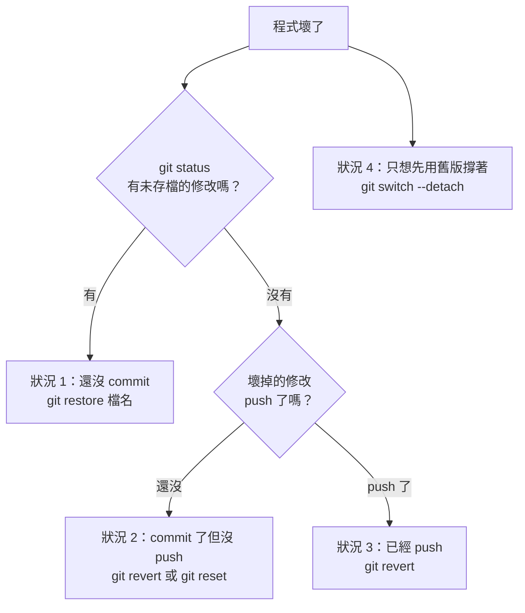

# 05　Git 與 GitHub：從零開始

> 對應原本需求的《21 從 GitHub 更新到本機》《22 把本機修改推回 GitHub》《23 建立安全的修改版本》《24 復原到上一個正常版本》《25 處理 merge conflict》與「第十階段」。

---

## 0. 先講結論：Git 對你來說是「保險」，不是工程工具

你不需要成為 Git 高手。你需要的是：

1. **改之前存檔**（commit／branch）→ 改壞了一定救得回來
2. **把好的版本傳上 GitHub**（push）→ 電腦壞了也不會失去
3. **另外兩台下載最新版**（pull）
4. **壞了就退回去**（restore／revert／switch）

整章的所有操作，都是這四件事的變化。

---

## 1. 觀念：用「遊戲存檔」來理解

| Git 名詞 | 白話 | 在你的專案裡 |
|---|---|---|
| **repository（倉庫、repo）** | 一個被 Git 管理的資料夾，裡面記得每一次存檔 | `transcript` 這整個資料夾 |
| **local repository（本機倉庫）** | 在你電腦上的那一份 | 桌機 `C:\Users\User\projects\yt-transcript`、筆電 `%USERPROFILE%\yt-transcript`、手機 `~/transcript` |
| **remote repository（遠端倉庫）** | 放在網路上的那一份 | GitHub 上的 `https://github.com/door410/transcript` |
| **origin** | 遠端倉庫的預設小名 | `origin` = 你的 GitHub 倉庫 |
| **commit（提交）** | **一個存檔點**：「在這個時間點，所有檔案長這樣」，附上一句說明 | 例如 `1892eae 介面微調，並吸收 mobile/ 的有用部分後移除重複` |
| **commit hash** | 每個存檔點的編號（一串英數字，通常只看前 7 碼） | `1892eae` |
| **clone（複製）** | 第一次把整個遠端倉庫**連同所有歷史存檔**下載到本機 | 安裝指南裡的 `git clone https://github.com/door410/transcript.git` |
| **pull（拉）** | 把遠端的新存檔下載下來，並合併到本機 | 筆電、手機更新時用 |
| **push（推）** | 把本機的新存檔上傳到遠端 | 桌機改完後用 |
| **branch（分支）** | **平行的存檔線**。在分支上亂改都不會影響主線 | 主線叫 `main` |
| **main** | 主線。**永遠保持「可以用」的狀態** | 三台平常都在 main |
| **merge（合併）** | 把一條分支的修改併進另一條 | 分支測好了，併回 main |
| **switch（切換）**（舊稱 checkout） | 換到另一條分支或另一個存檔點 | |
| **HEAD** | 「你現在站在哪個存檔點」 | |
| **tag（標籤）** | 幫某個存檔點取一個好記的名字 | 例如 `v2026.09.24-穩定` |
| **release（發行版）** | GitHub 網站上的功能：把某個 tag 包成可下載的版本頁面 | 選用，一個人維護可以不用 |
| **working tree（工作區）** | 你現在看到、正在編輯的檔案 | |
| **staging（暫存區）／add** | 「這次存檔要包含哪些檔案」的清單 | `git add` |
| **diff（差異）** | 「和上次存檔比，改了哪些地方」 | |

### 一張圖看懂

```
   GitHub（遠端 origin）
   ○──○──○──○  main
              ▲ push       │ pull
              │            ▼
   桌機（本機）              筆電／手機（本機）
   ○──○──○──○  main         ○──○──○──○  main
          └──●──●  分支：試新功能（main 不受影響）
```

GitHub 官方文件的說法是：clone 會把整個 repository 的資料和完整版本歷史帶到本機；branch 讓你的修改和主要版本隔離。
**翻譯成你的情境：每一台機器上都有一份完整的歷史備份；在分支上試東西，壞了就丟掉分支，main 毫髮無傷。**

---

## 2. 第一次設定（每台機器做一次）

### 桌機、筆電（Windows）

1. 安裝 Git：<https://git-scm.com/download/win>（一路按預設）
2. 開「命令提示字元」（Win 鍵 → 輸入 `cmd`）
3. 設定你的名字與信箱（會記錄在每個存檔點上）：

```bash
git config --global user.name "door410"
```

```bash
git config --global user.email "aillm000410@gmail.com"
```

4. 第一次 `git push` 時，會跳出瀏覽器要你登入 GitHub。登入後 Windows 會記住，之後不用再登入。

### 手機（Termux）

```bash
pkg install -y git
```

**建議：手機只做 `git pull`，不做 `git push`。** 手機上 push 需要另外設定 GitHub token，麻煩且容易出錯；而且依照第 02 章的鐵則，你本來就只在桌機改程式。

---

## 3. 每天最常用的三個指令

所有指令都要先 `cd` 進入專案資料夾：

```bash
cd C:\Users\User\projects\yt-transcript
```

### `git status`：現在狀況如何？

```bash
git status
```

**做任何事之前先打這個。** 你會看到其中一種：

| 看到 | 意思 | 該怎麼辦 |
|---|---|---|
| `nothing to commit, working tree clean` | 沒有未存檔的修改 | 安全，可以做任何事 |
| `Changes not staged for commit:` + 檔名 | 有檔案被改了，還沒存檔 | 要嘛 commit，要嘛 restore 丟掉 |
| `Untracked files:` + 檔名 | 有新檔案，Git 還沒開始管 | 要的話 `git add`，不要的話刪掉 |
| `Your branch is ahead of 'origin/main' by 2 commits` | 本機有 2 個存檔點還沒 push | 可以 push |
| `Your branch is behind 'origin/main' by 3 commits` | GitHub 上有 3 個新存檔點 | 可以 pull |
| `On branch main` | 你現在在 main | |
| `HEAD detached at ...` | 你站在某個舊存檔點上（不是任何分支） | 看完要 `git switch main` 回來 |

### `git log --oneline`：看存檔歷史

```bash
git log --oneline -10
```

輸出像這樣（最上面是最新的）：

```
1892eae 介面微調，並吸收 mobile/ 的有用部分後移除重複
6e60574 合併遠端上傳的 mobile/ 目錄
547b7a9 介面：連結清空按鈕，逐字稿輸出改為可直接編輯
```

左邊的 7 碼就是 commit hash，要退版時會用到。按 `q` 離開。

### `git diff`：我改了什麼？

```bash
git diff
```

- 開頭是 `-` 的紅色行：被刪掉的
- 開頭是 `+` 的綠色行：新增的
- **AI 幫你改完程式後，一定要看 diff。** 如果看到一大片你沒要求的紅色（被刪掉的），就是 AI 亂改了。
- 按 `q` 離開。

> **更輕鬆的方式：** VS Code 左邊的「原始檔控制」圖示（像樹枝的那個）會列出所有改過的檔案，點一下就能左右對照看差異。**看 diff 強烈建議用 VS Code**。

---

## 4. 情境一：「我今天在本機修改了一個功能，怎麼安全地更新到 GitHub？」

### 最安全的完整流程（用分支）

```bash
# 1. 確認起點是乾淨的
git status
git switch main
git pull

# 2. 開一條新分支，取一個描述修改內容的名字
git switch -c feature/exam-mode

# 3. 改程式（自己改或照 AI 的建議改）

# 4. 檢查
git diff
python tools/selfcheck.py

# 5. 實際跑一次（雙擊 疑難排解.bat，轉一部影片）

# 6. 存檔
git add ytscript.py ui.html
git commit -m "新增考試複習分析模式"

# 7. 回到 main，把分支併進來
git switch main
git merge feature/exam-mode

# 8. 在 main 上再跑一次檢查
python tools/selfcheck.py

# 9. 上傳到 GitHub
git push

# 10. 分支用完可以刪掉
git branch -d feature/exam-mode
```

### 每一步為什麼要做

| 步驟 | 為什麼 |
|---|---|
| 1 `pull` | 先拿到最新版，避免之後衝突 |
| 2 開分支 | **保險。** 改壞了直接 `git switch main`，當作沒發生過 |
| 4 `diff` | 確認只改了你要改的地方 |
| 4 selfcheck | 確認沒弄壞原本的功能 |
| 5 實際跑 | selfcheck 不是萬能，真的用一次最準 |
| 6 `add` + `commit` | 建立存檔點。`add` 後面列出**你有意修改的檔案**，不要用 `git add .` 把所有東西都加進去（可能夾帶不想要的檔案） |
| 7 `merge` | 把測好的修改併回主線 |
| 9 `push` | 傳上 GitHub，其他兩台才拿得到 |

### commit 訊息怎麼寫

- 用中文，一句話說「**做了什麼**」：
  - ✅ `新增考試複習分析模式`
  - ✅ `修正長影片分份時章節時間錯誤`
  - ✅ `requirements：faster-whisper 升到 1.3.0（selfcheck --whisper 通過）`
  - ❌ `update`、`修改`、`fix`（一年後你完全看不出是什麼）
- 如果是 AI 建議的修改，可以在訊息後面註明，例如 `（依 GPT 建議修改 split_parts）`

### 簡化版（很小的修改，例如改一個錯字）

```bash
git status
git diff
python tools/selfcheck.py
git add ytscript.py
git commit -m "修正提示詞錯字"
git push
```

---

## 5. 情境二：「GitHub 上有新的版本，怎麼安全地更新到我的本機？」

### 桌機、筆電

```bash
cd %USERPROFILE%\yt-transcript
git status
```

- 如果是 `working tree clean` → 直接：

```bash
git pull
python tools/selfcheck.py
```

- 如果有未存檔的修改 → 先決定要不要：
  - **不要了：** `git restore .`（丟掉所有未存檔修改）然後 `git pull`
  - **要：** 先 `git add` + `git commit`，再 `git pull`（可能需要合併，見情境三）

**pull 完之後：**
1. 如果這次更新有改到 `requirements/`（pull 的訊息會列出改了哪些檔案），重跑一次 `安裝.bat`
2. **重新啟動程式**：舊的伺服器可能還在背景跑舊版。關掉瀏覽器分頁等 5 分鐘，或開「工作管理員」結束 `pythonw.exe`，再雙擊捷徑

### 手機

```bash
cd ~/transcript
git status
git pull
```

然後重新啟動：從 Termux 通知列按「Exit」關掉 Termux，再點桌面小工具啟動。**就這樣。**

手機直接執行 `~/transcript` 裡的程式（`~/ytscript/start.sh` 只是啟動器），所以 pull 下來的就是新版。

**只有這些情況要再跑一次安裝腳本：** pull 的訊息列出 `android/install.sh` 或 `requirements/` 有改動，
或自我檢查叫你重跑。

```bash
bash android/install.sh
```

> **2026-09-24 以前安裝的手機：** 以前的安裝方式是把程式「複製」到 `~/ytscript/` 執行，
> `git pull` 不會更新那份副本。請重跑一次 `bash android/install.sh`，它會自動換成新方式並清掉舊副本。
> 自我檢查的「手機啟動器指向這個資料夾」會告訴你是不是已經換好了：
>
> ```bash
> python tools/selfcheck.py
> ```

---

## 6. 情境三：「我修改了自己的版本，但 GitHub 上也有新東西，怎麼辦？」

這會發生在：你在筆電上改了東西，同時桌機也改了並 push 了。
（2026-09-22 真的發生過：從 GitHub 網頁上傳了 `mobile/`，同時本機也有修改，最後產生了一個合併存檔 `6e60574`。）

### 步驟

```bash
# 1. 先把自己的修改存檔
git add 你改的檔案
git commit -m "說明"

# 2. 拉下 GitHub 的新東西
git pull
```

接下來有兩種結果：

**結果 A：Git 自動合併成功（大多數情況）**
- 兩邊改的是不同檔案，或同一檔案的不同地方 → Git 自己搞定
- 可能會跳出一個文字編輯器要你確認合併訊息 → 直接存檔關閉即可
  （如果是黑底的 vim 編輯器：按 `Esc`，輸入 `:wq`，按 Enter）
- 跑 `python tools/selfcheck.py` → 通過 → `git push`

**結果 B：出現 `CONFLICT`（衝突）**
- 兩邊改了**同一個檔案的同一個地方**，Git 不知道該用誰的 → 見第 7 節

### 預防勝於治療

**遵守第 02 章的鐵則：只在桌機改程式。** 那麼另外兩台永遠只有「pull」，永遠不會衝突。

---

## 7. 處理 merge conflict（合併衝突）

### 衝突長什麼樣

`git pull` 或 `git merge` 後看到：

```
CONFLICT (content): Merge conflict in ytscript.py
Automatic merge failed; fix conflicts and then commit the result.
```

打開 `ytscript.py`，會看到這種標記：

```python
<<<<<<< HEAD
PROMPTS = {"deep": PROMPT_DEEP, "quick": PROMPT_QUICK, "exam": PROMPT_EXAM}
=======
PROMPTS = {"deep": PROMPT_DEEP, "quick": PROMPT_QUICK, "story": PROMPT_STORY}
>>>>>>> origin/main
```

意思是：
- `<<<<<<< HEAD` 到 `=======` 之間：**你本機的版本**
- `=======` 到 `>>>>>>>` 之間：**GitHub 上的版本**

### 怎麼解決

1. 決定最後要長什麼樣。上面的例子，兩個新模式都要，就改成：

   ```python
   PROMPTS = {"deep": PROMPT_DEEP, "quick": PROMPT_QUICK, "exam": PROMPT_EXAM, "story": PROMPT_STORY}
   ```

2. **把三行標記（`<<<<<<<`、`=======`、`>>>>>>>`）全部刪掉**
3. 整個檔案搜尋 `<<<<<<<`，確認沒有漏掉的衝突
4. 跑 `python tools/selfcheck.py`（衝突標記沒刪乾淨會在「主程式可以載入」失敗）
5. 存檔：

```bash
git add ytscript.py
git commit -m "合併：保留考試複習與故事模式"
git push
```

> **VS Code 會幫你：** 衝突處會出現「接受目前的變更／接受傳入的變更／接受兩者」按鈕，點一下就好。

### 搞不定的時候：放棄這次合併

```bash
git merge --abort
```

回到合併前的狀態，什麼都沒發生。然後可以把衝突的兩段程式都貼給 AI，請它幫你合併（第 08 章有提示詞）。

---

## 8. 情境四：「更新之後壞掉了，怎麼回到昨天的版本？」

**先判斷你在哪一種狀況：**



### 狀況 1：改了但還沒 commit → 直接丟掉修改

```bash
git restore ytscript.py
```

丟掉所有檔案的修改：

```bash
git restore .
```

⚠️ 丟掉就找不回來了。不確定的話先 `git diff` 看一下。

### 狀況 2 與 3：已經 commit（不管有沒有 push）→ 用 `revert` 撤銷

`revert` 會**新增一個存檔點**，內容是「把某次修改反過來做」。歷史不會被刪除，所以永遠安全。

```bash
git log --oneline -10
```

找到壞掉的那次 commit，例如 `a1b2c3d 新增考試複習分析模式`：

```bash
git revert a1b2c3d
```

（跳出編輯器就直接存檔關閉）

```bash
python tools/selfcheck.py
git push
```

另外兩台 `git pull` 就會一起退回。**pull 完記得重新啟動程式。**

> **為什麼不用 `git reset --hard`？** 它會直接刪掉存檔點。如果已經 push 過，還會讓本機和 GitHub 對不上，之後 push 會被拒絕。對你來說，`revert` 永遠是比較安全的選擇。

### 狀況 4：先用舊版撐著，之後再慢慢修

```bash
git log --oneline -20
git switch --detach 547b7a9
```

現在所有檔案都變回 `547b7a9` 那時的樣子，可以正常使用。
（`git status` 會顯示 `HEAD detached`，這是正常的。）

> ⚠️ **別嚇到：** 退到比這份手冊更早的版本時，`docs/` 和 `tools/selfcheck.py` 會**暫時從資料夾裡消失**
> （因為那時候它們還不存在）。這不是被刪掉，`git switch main` 之後就會回來。
> 所以建議：**退版前先在 GitHub 網頁上打開這份手冊**，或另外存一份在別的地方。

要回到最新版時：

```bash
git switch main
```

**如果你有打 tag（第 9 節），更簡單：**

```bash
git switch --detach v2026.09.24
```

### 手機退版

```bash
cd ~/transcript
git switch --detach v2026.09.24
```

然後重新啟動程式。

回到最新版：

```bash
git switch main
git pull
```

然後重新啟動程式。

---

## 9. tag：幫「確定可用」的版本做記號

這個 repository 的第一個 tag 是 **`v2026.09.24`**（2026-09-24 建立，桌機實測通過；筆電、手機待測）。
之後**每次三台都測過、確定可用時**，就再打一個：

```bash
git tag -a v2026.10.15 -m "三台實測可用：桌機GPU、筆電CPU、手機"
git push origin v2026.10.15
```

- 命名建議用日期：`v年.月.日`，一看就知道是哪一天的版本
- 之後要退回：`git switch --detach v2026.09.24`
- 看所有 tag：`git tag`

### release（選用）

在 GitHub 網站：repository 首頁右邊 **Releases** → **Draft a new release** → 選 tag → 寫說明 → Publish。
好處是 GitHub 會自動產生 zip 下載連結，換電腦沒裝 Git 時也能下載某個版本。一個人維護可以不做。

---

## 10. 不要做的事

| 不要 | 為什麼 | 改用 |
|---|---|---|
| 在 GitHub 網頁上「Add files via upload」上傳程式 | 繞過本機 Git，造成分岔（9/22 就是這樣） | 本機 commit + push |
| `git push --force` / `git push -f` | 會覆蓋 GitHub 上的歷史，可能永久失去別台的修改 | `git pull` 合併後再 push |
| `git reset --hard`（已 push 的東西） | 刪除存檔點，與 GitHub 對不上 | `git revert` |
| `git add .` 不看就 commit | 可能夾帶暫存檔、密碼、大檔案 | `git add 檔名` 逐一列出 |
| 三台都改程式 | 衝突 | 只在桌機改 |
| 把 repository 放在 Google Drive 資料夾裡 | 雲端同步會和 Git 互相干擾，造成檔案損毀 | 放在 `C:\Users\User\...` 一般資料夾 |
| 在手機上改程式 | 違反「只在桌機改」的鐵則，容易和桌機衝突 | 回桌機改，手機只 `git pull` |

---

## 11. 練習（用你的專案，全部可以安全做）

### 練習 1：看狀態與歷史
```bash
git status
git log --oneline -10
```

### 練習 2：改了又丟掉
1. 在 `README.md` 最後打幾個字，存檔
2. `git status` → 看到 README.md 被改了
3. `git diff` → 看到你打的字
4. `git restore README.md` → 字消失了

### 練習 3：在分支上改，然後丟掉分支
```bash
git switch -c test/practice
```
改 `ui.html` 的「開始轉錄」為「開始」，存檔，然後：
```bash
git add ui.html
git commit -m "練習"
git switch main
```
打開 `ui.html` → 還是「開始轉錄」。main 完全沒被影響。
```bash
git branch -D test/practice
```

### 練習 4：看 tag，然後打自己的第一個
```bash
git tag
git show v2026.09.24 --stat
```
到 GitHub 網頁的 repository 首頁，點 `main` 下拉選單 → Tags，看到 `v2026.09.24`。

等你把筆電和手機都測過，自己打一個（日期換成當天）：
```bash
git tag -a v2026.10.01 -m "三台實測可用"
git push origin v2026.10.01
```

### 練習 5：退回舊版再回來
```bash
git switch --detach 547b7a9
```
打開 `ytscript.py`，搜尋 `opencc` → 找不到（那時還沒加簡繁轉換）。
你也會發現 `docs/` 資料夾不見了——那時候還沒有這份手冊。
```bash
git switch main
```
再搜尋 → 又出現了，`docs/` 也回來了。

**做完這五個練習，你已經會 Git 裡對你最重要的 80%。**

---

## 12. 指令速查卡

| 我想要… | 指令 |
|---|---|
| 看現在狀況 | `git status` |
| 看改了什麼 | `git diff` |
| 看歷史 | `git log --oneline -10` |
| 下載最新版 | `git pull` |
| 開新分支 | `git switch -c 分支名` |
| 切回主線 | `git switch main` |
| 存檔 | `git add 檔名` → `git commit -m "說明"` |
| 上傳 | `git push` |
| 丟掉未存檔的修改 | `git restore 檔名` |
| 撤銷某次存檔 | `git revert 編號` |
| 暫時用舊版 | `git switch --detach 編號或tag` |
| 合併分支 | `git switch main` → `git merge 分支名` |
| 放棄合併 | `git merge --abort` |
| 做版本記號 | `git tag -a v日期 -m "說明"` → `git push origin v日期` |
| 刪分支 | `git branch -d 分支名` |
